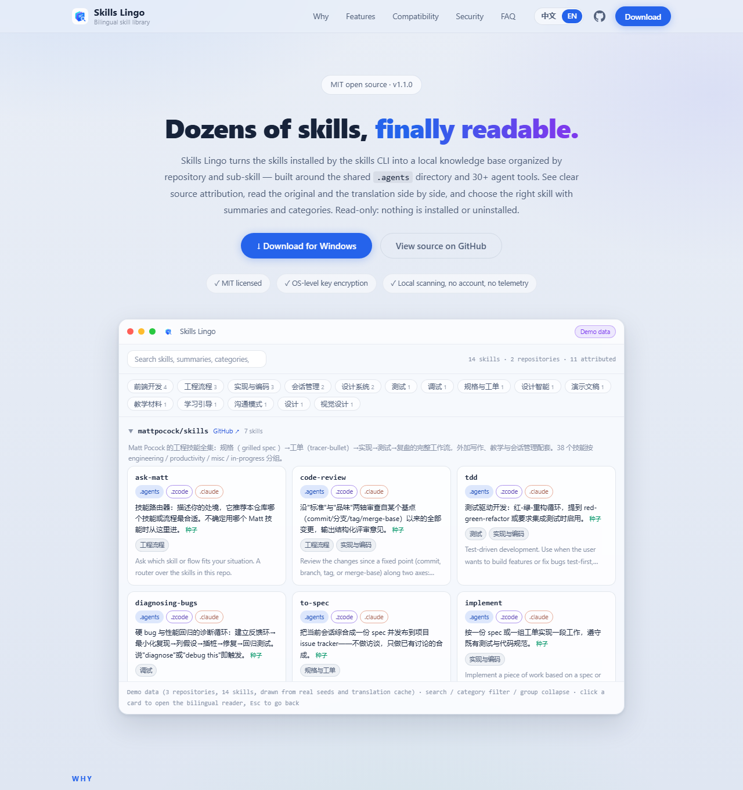

# Skills Lingo · A local skill viewer & translator

**English** | [中文](README.zh-CN.md)

[](https://github.com/TurkeyPro1025/skills-lingo/actions/workflows/ci.yml)
[](https://github.com/TurkeyPro1025/skills-lingo/releases/latest)
[](LICENSE)
[](#install)

> Skills Lingo (Skills 译站) turns the dozens of skills installed by the skills CLI into a local knowledge base organized by **repository → sub-skill** — built around the shared `.agents` directory and 30+ agent tools — with bilingual (English ↔ Chinese) reading section by section. When you don't know which skill to call, summaries and category filters help you choose. It only reads skill directories — it never installs or uninstalls anything.



## Why

CLIs such as [vercel-labs/skills](https://github.com/vercel-labs/skills) flatten dozens of sub-skills from one repository into local directories, and those directories are shared by several tool roots such as `.agents`, `.zcode` and `.codex`. Over time:

- **Hard to read**: `SKILL.md` files are almost entirely in English, and reading dozens of them one by one is exhausting.
- **Unclear provenance**: skill folders are mixed together, so it's hard to tell which repository each one belongs to.
- **Duplicates everywhere**: the same skill appears under several tool roots, as if it had been installed multiple times.
- **Hard to choose**: with dozens of skills sitting there, it's easy to forget what each one does and which one to call.

One scan with Skills Lingo gives you:

- **Bilingual reading**: documents in the interface language are shown in a single column; other documents get a section-by-section translation in the interface language (Chinese ↔ English).
- **Browsing by purpose** — engineering workflow, writing, debugging, research and more — with one-line summaries that help you pick the right skill.
- **Precise attribution** to the source repository: the install manifest is read first; without a record, the source is inferred level by level and clearly labeled.
- **Agent coverage**: see which tool roots are active, which entries are copies, and where content has diverged.
- **Manual grouping** when you want to correct or confirm an automatic inference.

## Features

- **Block-level bilingual reading.** Original and translation aligned section by section. Code blocks, commands, URLs, paths and environment variables are extracted before translation and restored afterwards — never rewritten. Documents whose language matches the interface are shown in a single column; switching the UI language changes the translation target and keeps a separate cache per language. In non-Chinese UIs the card summary is the frontmatter description, and category tags and repository blurbs are translated and cached too.
- **Categorized quick reference.** A one-line summary explains what a skill is and when to use it. Click a category tag (engineering workflow, writing, debugging and so on) to filter instantly, alongside search and repository grouping. Built-in seeds cover common skills; an optional LLM fills in the rest.
- **Translation-friendly by design.** Translations are generated when a document is first opened, reused while the content is unchanged, and deduplicated across concurrent requests. Long documents are chunked with global throttling; attached documents are translated on demand.
- **Lock-file attribution engine.** Reads the skills CLI install manifest `.skill-lock.json` first. Without a record, it falls back to the `.git` remote, frontmatter source and LLM inference, marking inferred sources as "unconfirmed". Manual grouping always wins.
- **Multi-root deduplication.** Junctions and symlinks are merged by real path; identical independent copies are merged and counted; diverged copies with the same name are shown as separate versions.
- **Desktop and web.** The web version (Node ≥ 20) and the desktop version (no Node required, tray-resident) share the same UI and API contract and point to the same data directory by default (on Windows, `%APPDATA%\skills-lingo`). A document translated on one side is already translated on the other, with no configuration. To store data separately or move it, override `dataDir` in `config.json`.

## Install

### Desktop (Windows, recommended)

Download from [GitHub Releases](https://github.com/TurkeyPro1025/skills-lingo/releases/latest):

- Installer: `Skills Lingo_<version>_x64-setup.exe`.

Use the actual filename shown on the Releases page. The app stays in the system tray by default: closing the window minimizes it, and right-clicking the tray icon exits. Startup on boot and "exit on close" can be enabled in settings. The installer is not code-signed, so Windows may show an "Unknown publisher" warning — choose "Run anyway".

### Web (run from source)

Prerequisite: [Node.js](https://nodejs.org/) ≥ 20 (zero npm dependencies — no `npm install` needed).

```bash
git clone https://github.com/TurkeyPro1025/skills-lingo.git
cd skills-lingo
node server.js
```

Open `http://127.0.0.1:4763`.

### Build the desktop app from source (optional)

For developers who want to modify or repackage the app. Requires Node ≥ 20, the Rust toolchain, and the Windows build dependencies for Tauri 2 (see [Tauri prerequisites](https://v2.tauri.app/start/prerequisites/)). From `desktop/`:

```bash
cd desktop
npm install
npx tauri build
```

Output: `desktop/target/release/skill-viewer-desktop.exe` and the installers under `desktop/target/release/bundle/nsis/`. Build and test conventions are in [CONTRIBUTING.md](CONTRIBUTING.md).

### Configure translation and the LLM

Open **⚙ Settings** in the top-right corner:

- **Translation service**: UApiPro cloud translation. Paste the API key → **Test connection (free)** → Save to enable bilingual reading (4 credits per call; long documents are chunked and billed per call; a privacy confirmation appears on first use).
- **LLM service**: choose a preset (DeepSeek / Zhipu GLM / custom OpenAI-compatible) → enter the key → **Test connection** → Save to generate Chinese summaries and attribution inferences. In non-Chinese UIs the card summary uses the frontmatter description instead, so no LLM summary is generated.

> The app UI is available in **Chinese and English**. Switch languages with the picker in the top-right corner; UI copy and the translation target language change together, and translations (documents, summaries, category tags and repository blurbs) are cached per language.

### CLI options

```bash
node server.js --port 4763 --host 127.0.0.1 --config config.json --no-scan
```

## Security and privacy

**API keys (read this)**

- Keys are entered only on the settings page and encrypted to disk with the OS credential store (Windows DPAPI / macOS Keychain / Linux secret-tool) plus AES-256-GCM. No file contains plaintext.
- The key is never sent back to the browser in plaintext: the UI and every endpoint return only a mask (first 3 / last 4 characters for long keys; shorter keys show less).
- A credentials file copied to another machine or user cannot be decrypted. You can clear the saved key at any time in settings.

**Local API**

- Listens on `127.0.0.1` by default. Do not change `host` to `0.0.0.0` via `--host` or `config.json` — that would expose the read-only API to your local network.
- All state-changing requests (POST) enforce same-origin validation: cross-site writes with forged Host/Origin headers and DNS rebinding are rejected with 403.
- No endpoint returns the full key; caches, indexes and state files contain no plaintext either.

**Document content**

- **Translation**: explicit consent is required before bilingual reading is enabled. Without consent, no new translation requests are sent, but locally cached translations remain viewable. After consent, the body of the document you open is sent, and switching the UI language also translates skill summaries, category tags and repository blurbs into that language; the results are cached. **Manual update** pre-translates all entry-point `SKILL.md` files whose language differs from the current interface language, provided consent has been given and a translation service is configured.
- **LLM**: once an LLM is saved and enabled, analysis sends the frontmatter description and first 3,000 characters of the body for skills without summaries, and the first 4,000 characters of `SKILL.md` for skills without attribution, to the LLM service you configured. This can happen at startup and is not limited to documents you have opened; there is no separate consent dialog.
- Code blocks, commands, paths and environment variables are extracted before sending; translation never rewrites these fragments.
- Scanning, deduplication and search all run locally. Without an LLM configured, nothing leaves your machine except translation requests.

## Configuration (optional)

Every field in `config.json` has a default, and `~` expands to your home directory. Copy `config.example.json` to `config.json` in the startup directory:

| Field | Description |
| --- | --- |
| `port` / `host` | Listen port and address, defaults `4763` / `127.0.0.1` |
| `roots` | Skill root directories, scanned with real-path deduplication |
| `lockFiles` | Install manifest files |
| `dataDir` | Data directory: indexes, summaries, translations, manual groupings, plus encrypted `credentials.enc`, `providers.json` and `state.json` |
| `providers.translate` | Translation endpoint and parameters (the key is not stored here; it uses encrypted storage) |

## Contributing

See [CONTRIBUTING.md](CONTRIBUTING.md) for the architecture, extension points and testing conventions. Contributions are welcome in both English and Chinese.

## License

MIT
